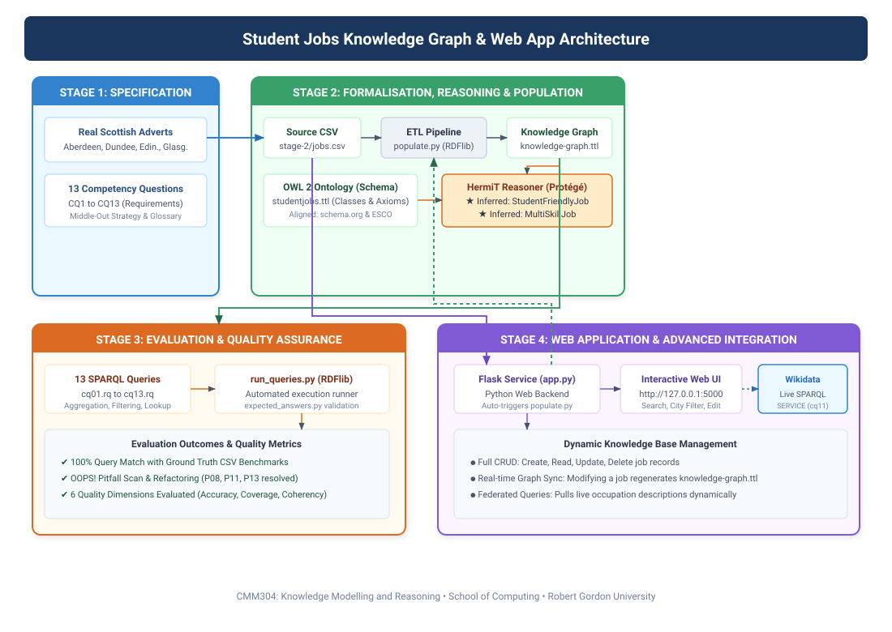
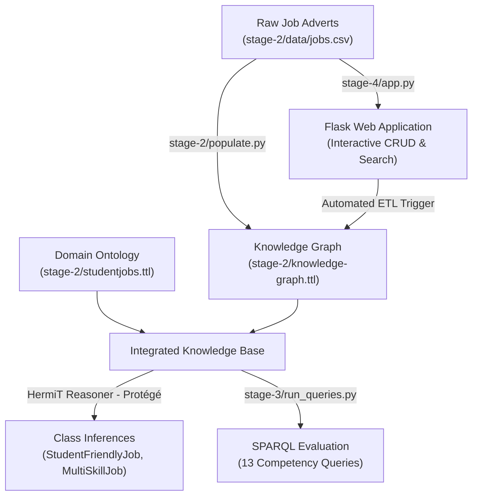

# Student Part-Time Jobs Knowledge Graph & Web Application
> **Module:** CMM304 Knowledge Modelling and Reasoning (MSc Artificial Intelligence)
> **Institution:** Robert Gordon University (RGU), School of Computing
> **Student:** Juhi Shah (Student ID: 2617188)
> **Module Coordinator:** David Corsar
> **Target Branch for Marking:** `main`

---

> *GenAI Acknowledgment:* This assessment was prepared with assistance from AI tools (Claude, Antigravity, etc.). The AI usage is documented in the reflective statement (`reflective-statement.md`).

##  Executive Summary

This repository contains the complete, end-to-end coursework submission for **CMM304 Knowledge Modelling and Reasoning**. Grounded in a **Middle-Out** ontology engineering methodology, the project models student employment opportunities across Scotland (Aberdeen, Dundee, Edinburgh, and Glasgow), capturing vacancies, required skills/competencies, employer profiles, recurring shift schedules, and hourly pay.

The repository is structured into four sequential stages mapping directly to the knowledge engineering lifecycle:
1. **Stage 1 (Specification):** Requirements analysis, Middle-Out strategy justification, 13 Competency Questions (CQs), glossary, data dictionary, and conceptual model.
2. **Stage 2 (Formalisation, Implementation & Population):** OWL 2 ontology (`studentjobs.ttl`), Description Logic reasoning with HermiT, external alignment to Schema.org and ESCO, and automated CSV-to-RDF ETL pipeline (`populate.py`).
3. **Stage 3 (Evaluation):** 13 formal SPARQL queries (`cq01` to `cq13`), automated test execution, multi‑dimensional quality assessment, and OOPS! pitfall refactoring.
4. **Stage 4 (Web Application & Integration):** Interactive Flask web application (`app.py`) providing search, Scottish city filtering, full CRUD capabilities with automatic RDF knowledge graph synchronization, and Wikidata federation (`SERVICE`).
5. **Reflective Statement & AI Audit Log (`reflective-statement.md`):** Critical evaluation of tools used, detailed AI audit log documenting genuine errors and fixes, and design rationale.

## Architecture & Pipeline





##  Repository Organization

```text
cmm304-student-jobs-kg-updated/
│   readme.md               # Official assessment documentation (this file)
│   juhi.md                 # Student walkthrough, visual diagrams & viva prep (ELI5)
│   system-workflow-diagram.svg
│   requirements.txt        # Python dependencies (rdflib, SPARQLWrapper, Flask)
│   reflective-statement.md # 500‑word reflection & GenAI audit log
│
├── stage-1-specification.md
├── stage-1/
│   ├── glossary-and-data-dictionary.md
│   └── knowledge-graph-diagram.svg
│
├── stage-2-implementation.md
├── stage-2/
│   ├── studentjobs.ttl
│   ├── knowledge-graph.ttl
│   ├── populate.py
│   ├── reasoner-classification.png
│   └── ontology-diagram.svg
│
├── stage-3-evaluation.md
├── stage-3/
│   ├── run_queries.py
│   ├── expected_answers.py
│   └── queries/
│       └── *.rq
│
├── stage-4-webapp.md
├── stage-4/
│   └── app.py
└── view_ttl.py
```

---

##  Setup & Execution Instructions

### Prerequisites
* **Python:** 3.10+.
* **Protégé:** 5.5+ with HermiT reasoner.
* **OS:** Windows, macOS, or Linux.

### 1. Environment Setup
```bash
# From the project root
python -m venv .venv
# Windows PowerShell
.venv\Scripts\Activate.ps1
# Install dependencies
pip install -r requirements.txt
```

### 2. Generate the Knowledge Graph
```bash
python stage-2/populate.py
```

### 3. Run SPARQL Evaluation (Stage 3)
```bash
python stage-3/run_queries.py
```
All 13 competency queries should pass.

### 4. Launch the Web Application (Stage 4)
```bash
python stage-4/app.py
```
Open `http://127.0.0.1:5000` in a browser.

---

## Competency Questions Summary

| ID | Natural Language Competency Question | Type | Query File |
|:---|:---|:---|:---|
| **CQ1** | Which jobs require communication skills? | Lookup | `stage-3/queries/cq01-communication.rq` |
| **CQ2** | Which jobs offer weekend schedules? | Lookup | `stage-3/queries/cq02-weekend.rq` |
| **CQ3** | Which skills are required for a barista job? | Relationship | `stage-3/queries/cq03-barista-skills.rq` |
| **CQ4** | Which jobs require more than one skill? | Aggregation | `stage-3/queries/cq04-multiple-skills.rq` |
| **CQ5** | Which jobs match a selected skill? | Parameterised | `stage-3/queries/cq05-selected-skill.rq` |
| **CQ6** | Which jobs does each employer offer? | Relationship | `stage-3/queries/cq06-employer-jobs.rq` |
| **CQ7** | Which jobs pay more than a given hourly rate? | Numerical Filter | `stage-3/queries/cq07-pay-above.rq` |
| **CQ8** | Which skills are required by more than one job type? | Aggregation | `stage-3/queries/cq08-shared-skills.rq` |
| **CQ9** | Which jobs are student-friendly? (inferred) | DL Inference | `stage-3/queries/cq09-student-friendly.rq` |
| **CQ10** | Which jobs can someone with a given skill set do? | Set Containment | `stage-3/queries/cq10-skill-set.rq` |
| **CQ11** | What does an external knowledge graph state about a job type? | Federated SPARQL | `stage-3/queries/cq11-federated-wikidata.rq` |
| **CQ12** | Which jobs are located in a selected Scottish city? | Geo-Lookup | `stage-3/queries/cq12-location.rq` |
| **CQ13** | Which Scottish locations have vacancies requiring Communication? | Relational Filter | `stage-3/queries/cq13-location-communication.rq` |

---

##  Metadata & Licence
* **Ontology IRI:** <http://example.org/studentjobs>
* **Author:** Juhi Shah (Student ID: 2617188)
* **Licence:** Creative Commons Attribution 4.0 International ([CC BY 4.0](https://creativecommons.org/licenses/by/4.0/))
* **External Alignments:** Schema.org (`schema:JobPosting`, `schema:Organization`, `schema:Place`), ESCO (`esco:Skill`)
