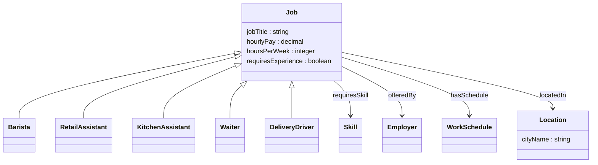

# Stage 1: Specification

## 1. Modelling and Knowledge Acquisition Strategy
I adopted a **Middle-Out** ontology engineering approach (Noy & McGuinness, 2001). The core concepts — Job, Skill, Employer, WorkSchedule, and Location — are concrete and familiar from UK student job adverts (Indeed UK; StudentJob UK), making them a stable middle layer. Starting purely top-down would have introduced abstract upper classes that no competency question requires, adding unnecessary complexity. Starting purely bottom-up would have risked inconsistency across advert wording, requiring extensive normalisation without a guiding schema.

**How I applied it:**

1. **Acquire.** I analysed 10 student part-time job adverts from Scottish employers' careers pages and UK job boards (Indeed UK, StudentJob UK), recording source terms and pay/hour norms aligned with UK student employment guidelines (UK Government, 2025). The CSV (`stage-2/data/jobs.csv`) contains these structured records.
2. **Extract and normalise.** Raw terms were merged and mapped to canonical competencies defined in the European **ESCO** skill taxonomy (European Commission, 2023): "good interpersonal skills" and "customer communication" → `Communication`; "till operations" → `CashHandling`; "thriving in peak lunch rushes" → `Multitasking`.
3. **Generalise upward.** Job titles were grouped into five occupational roles grounded in the UK **Standard Occupational Classification (SOC 2020)** (ONS, 2020) — `Barista`, `RetailAssistant`, `KitchenAssistant`, `Waiter`, and `DeliveryDriver` — under `Job`, aligned upward to `schema:JobPosting` (Schema.org, 2024).
4. **Decompose downward.** Vacancies (individuals) were separated from job types (classes); skill levels (Essential/Desirable) were simplified to direct `requiresSkill` after reviewing CQs.
5. **Validate.** Each concept was tested against all 13 competency questions; unused concepts were removed.

---

## 2. Ontology Requirements Specification Document (ORSD)

**Purpose.** Represent part-time job vacancies open to students across Scotland, together with required skills, employers, shift schedules, and locations, so that students and software agents can query and reason over employment opportunities.

**Scope.** Approximately 5 job types, 10 skills, 3 employers, 3 schedule patterns, and vacancy details (hourly pay, weekly hours, prior experience requirement). Four Scottish cities: Aberdeen, Dundee, Edinburgh, Glasgow.

**Intentionally excluded.** Full-time and graduate careers, application tracking, educational qualifications, employment law, live vacancy feeds, personal CVs.

**Target users.** Students seeking part-time work; university careers advisers; and the Flask web application as a software consumer.

---

## 3. Competency Questions (CQs)

A minimum of 10 CQs is required; this ontology supports 13.

| ID | Question | Type | Priority |
|---|---|---|---|
| CQ1 | Which jobs require communication skills? | Lookup | High |
| CQ2 | Which jobs offer weekend schedules? | Lookup | High |
| CQ3 | Which skills are required for a barista job? | Relationship | High |
| CQ4 | Which jobs require more than one skill? | Aggregation | Medium |
| CQ5 | Which jobs match a selected skill? | Parameterised | High |
| CQ6 | Which jobs does each employer offer? | Relationship | Medium |
| CQ7 | Which jobs pay more than a given hourly rate? | Numerical filter | Medium |
| CQ8 | Which skills are required by more than one job type? | Aggregation | Medium |
| CQ9 | Which jobs are student-friendly? (inferred) | DL Inference | High |
| CQ10 | Which jobs can someone with a given skill set do? | Set containment | Medium |
| CQ11 | What does an external knowledge graph state about a job type? | Federation | Low |
| CQ12 | Which jobs are located in a selected Scottish city? | Parameterised lookup | High |
| CQ13 | Which Scottish locations have vacancies requiring Communication? | Relational filter | Medium |

---

## 4. Conceptual Model & Knowledge Acquisition

The full glossary and data dictionary are in [stage-1/glossary-and-data-dictionary.md](stage-1/glossary-and-data-dictionary.md).

**Key modelling decisions:**
- Job types are **classes** (Barista, Waiter, etc.) and individual vacancies are **individuals** (BAR01, WAI01, etc.) — this supports both class-level reasoning (CQ3: skills for all Barista jobs) and individual queries (CQ7: pay for a specific vacancy).
- Skills, schedules, and employers are **individuals** so SPARQL can join across them.
- `Location` is a **separate class** (not merged with Employer) because one employer may advertise vacancies in multiple Scottish cities.
- `StudentFriendlyJob`, `MultiSkillJob`, and `WeekendJob` are **defined classes** (necessary and sufficient conditions) so the HermiT reasoner can automatically classify vacancies into them.

**Taxonomy and relations diagram:**

---

## 5. Design Patterns & Reuse

- **N-ary relation pattern** (optional) for recording whether a skill is essential or desirable — omitted as only 2 of 10 adverts distinguished skill levels explicitly.
- **schema.org** (`schema:JobPosting`, `schema:Organization`, `schema:Place`) — web interoperability.
- **ESCO** (`esco:Skill`) — European labour-market skill taxonomy. Alignment via `rdfs:subClassOf` and `skos:closeMatch` in `stage-2/studentjobs.ttl`.

---

## References
*(Excluded from word count per RGU Assessment Policy)*
- European Commission (2023) *ESCO: European Skills, Competences, Qualifications and Occupations*. Available at: https://esco.ec.europa.eu/
- Noy, N.F. and McGuinness, D.L. (2001) *Ontology Development 101: A Guide to Creating Your First Ontology*. Stanford Knowledge Systems Laboratory Technical Report KSL-01-05.
- Office for National Statistics (ONS) (2020) *Standard Occupational Classification (SOC 2020)*. Available at: https://www.ons.gov.uk/
- Schema.org (2024) *JobPosting, Organization, and Place Schemas*. Available at: https://schema.org/
- UK Government (2025) *National Minimum Wage and National Living Wage Rates / Student Part-Time Employment*. Available at: https://www.gov.uk/national-minimum-wage-rates
